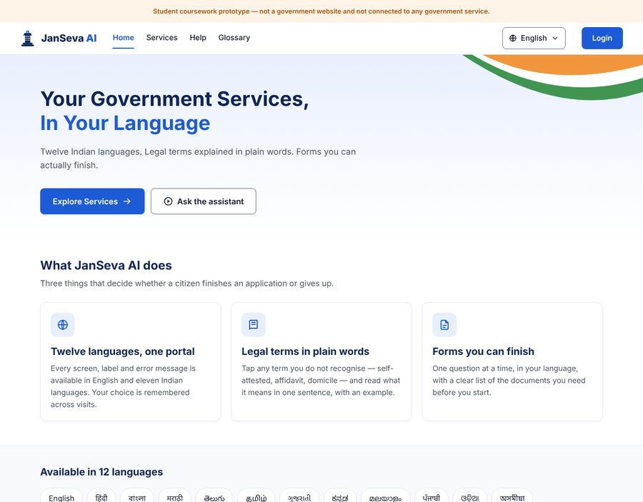
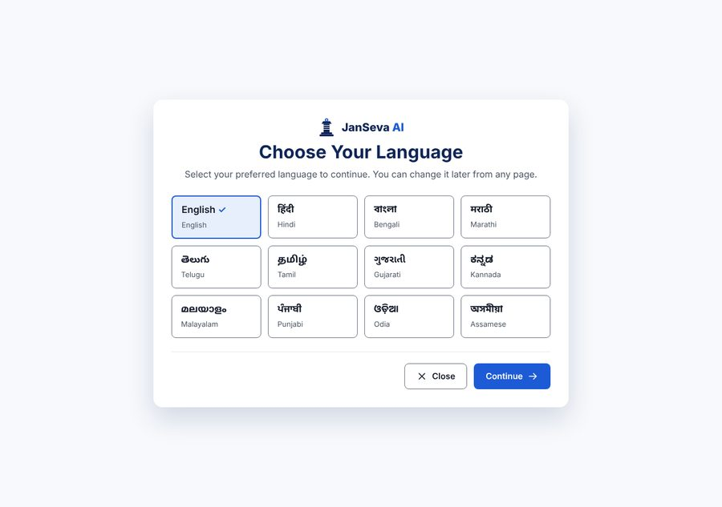
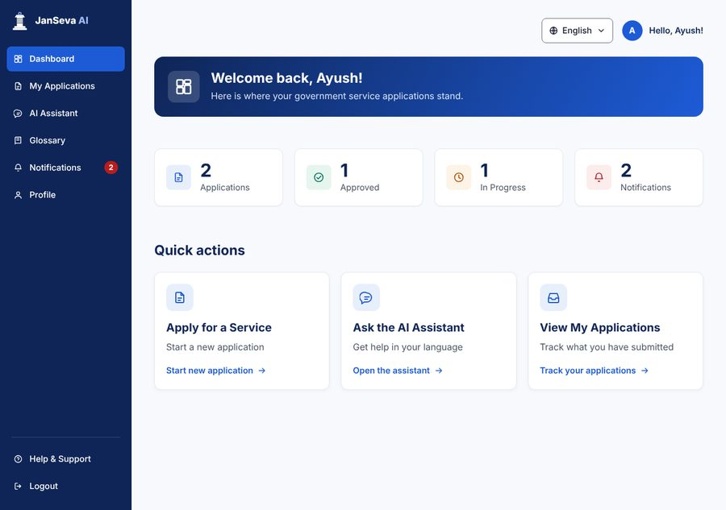
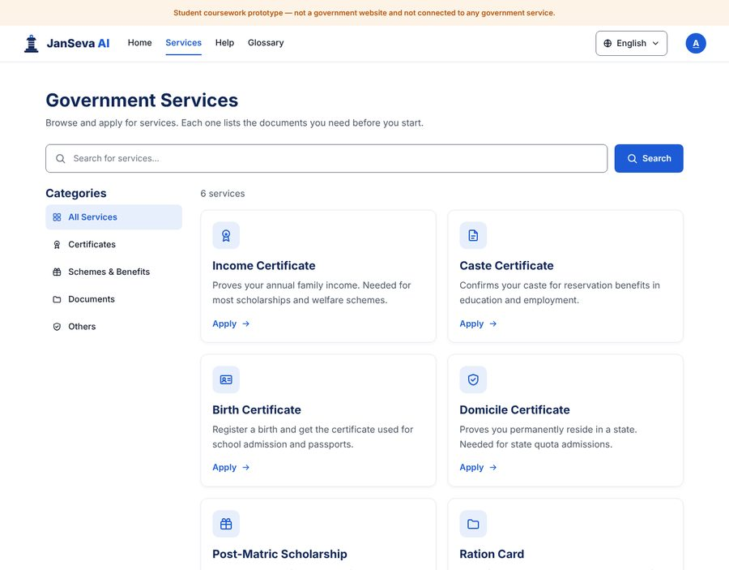
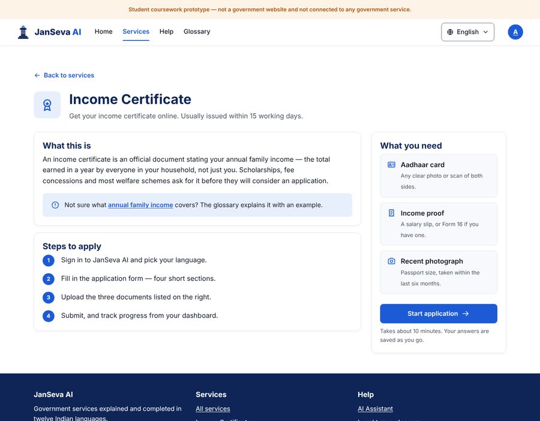
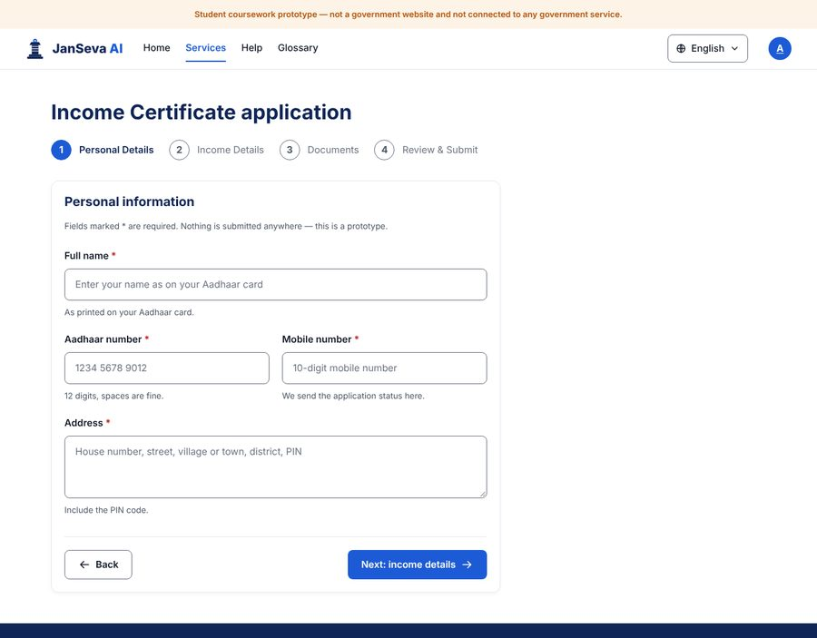
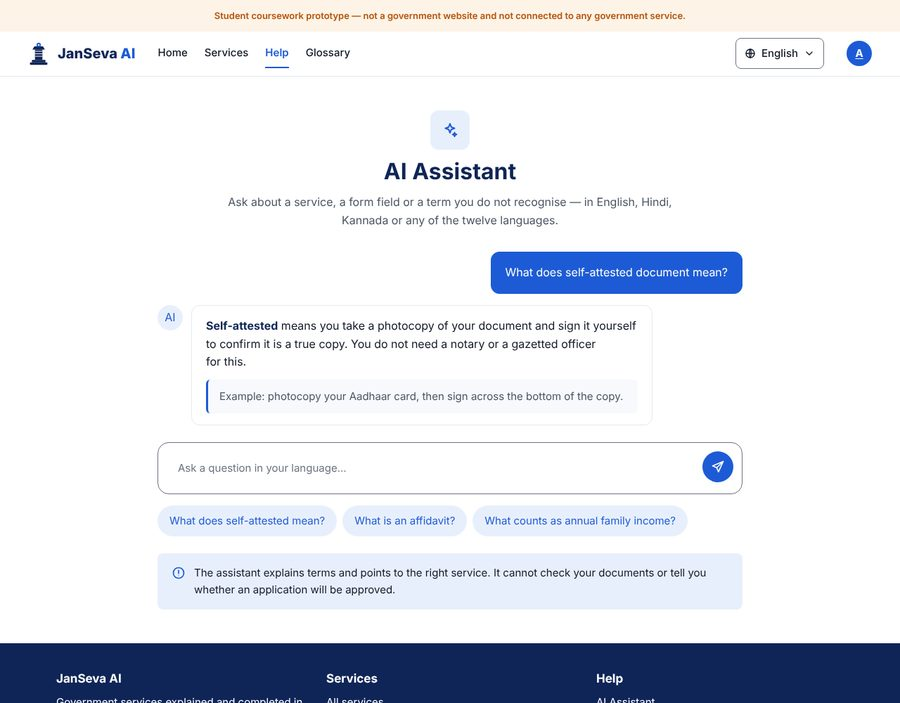
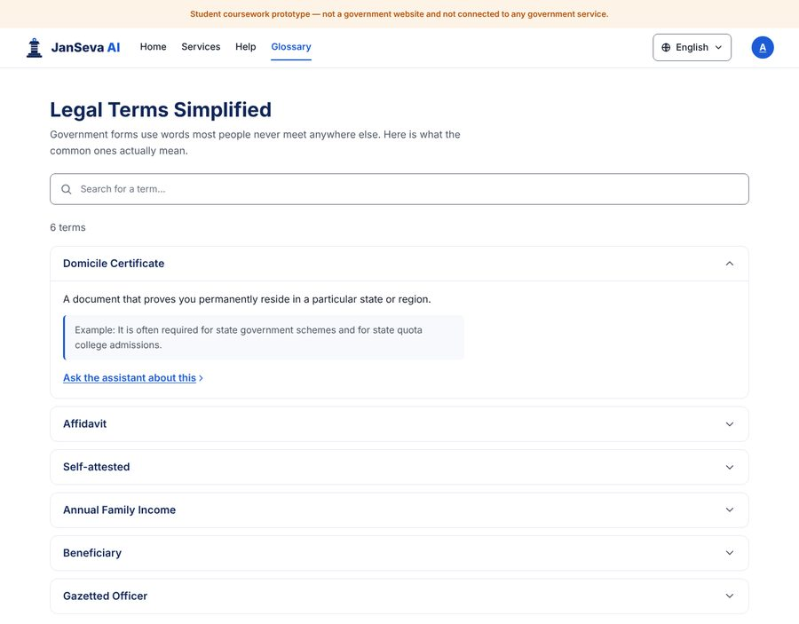
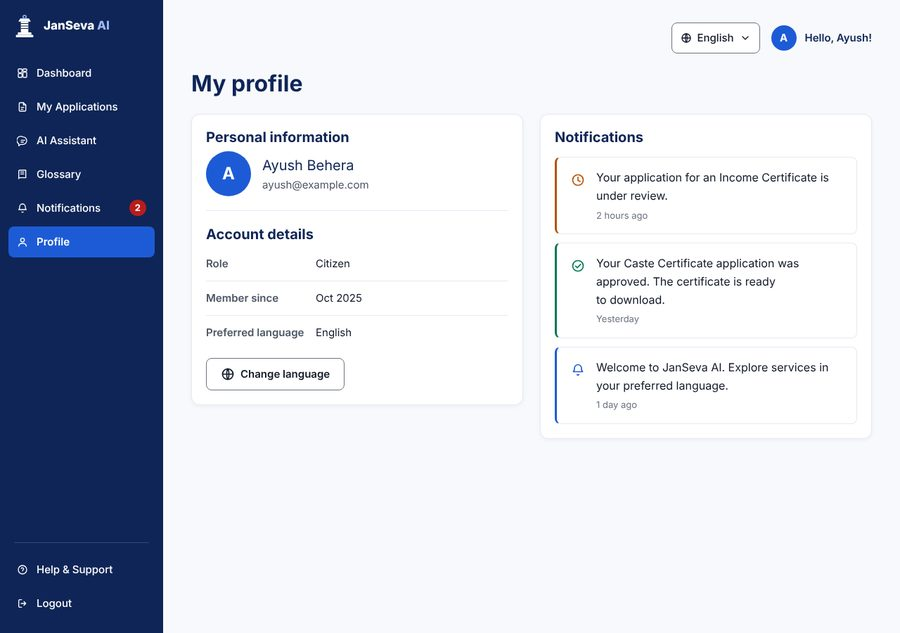

# JanSeva AI — twelve-language government service portal

A front-end prototype of a citizen portal that lets people find, understand and
complete Indian government service applications in **twelve languages**.

Built as coursework for the Advanced UI/UX course at East Point College of
Engineering and Technology (Problem 7 — Twelve-Language Government Service
Portal).

> **This is a design prototype.** It is not a government website, is not
> affiliated with or endorsed by any government body, and submits nothing
> anywhere. Every page carries that notice.



---

## The problem

India recognises 22 scheduled languages, but most government service portals
are usable only in English and Hindi. Three things stop people finishing an
application:

1. **Language.** The interface is in a language they do not read.
2. **Vocabulary.** Even in their own language, forms use terms — *self-attested*,
   *affidavit*, *domicile*, *annual family income* — that nobody uses in
   conversation.
3. **Form design.** Long forms with no indication of what documents are needed
   until halfway through.

This prototype addresses each one: twelve languages across the whole shell, a
plain-language glossary and an assistant that explains terms on demand, and
forms that list required documents before you start.

---

## Pages

| File | Page | What it covers |
|---|---|---|
| `index.html` | Landing | Value proposition, the twelve languages, entry points |
| `language.html` | Language selection | All twelve, each in its own script |
| `dashboard.html` | Dashboard | Application counts, quick actions |
| `services.html` | Services | Searchable, filterable service catalogue |
| `service-income-certificate.html` | Service detail | What it is, steps, documents needed |
| `apply.html` | Application form | Step 1 of 4, with live validation |
| `assistant.html` | AI assistant | Ask about a term or a service |
| `glossary.html` | Glossary | Legal terms in plain words, with examples |
| `profile.html` | Profile & notifications | Account details, application updates |

Every page links to the others, so the whole citizen journey is walkable:
**Landing → Language → Dashboard → Services → Service detail → Form**.

### Screens

| | |
|---|---|
|  **Language selection** — all twelve, each in its own script |  **Dashboard** — counts and quick actions |
|  **Services** — searchable catalogue |  **Service detail** — steps and documents |
|  **Application form** — four steps, live validation |  **AI assistant** — terms explained on demand |
|  **Glossary** — plain-language definitions |  **Profile** — account and notifications |

---

## Running it

No build step, no dependencies, no server required.

```bash
git clone https://github.com/<your-username>/janseva-ai.git
cd janseva-ai
open index.html          # macOS;  on Windows: start index.html
```

Opening `index.html` directly from the filesystem works — icons are inlined and
fonts are self-hosted with relative paths, so nothing needs a server.

To serve it over HTTP instead (closer to production, and what GitHub Pages does):

```bash
python3 -m http.server 8000
# then visit http://localhost:8000
```

### Publishing to GitHub Pages

Push the repository, then in **Settings → Pages** choose the `main` branch and
the `/ (root)` folder. The site is live at
`https://<your-username>.github.io/janseva-ai/` within a minute or so.

---

## Project structure

```
📁 janseva-ai/
├── 📄 index.html                        Landing page
├── 📄 language.html                     Language selection
├── 📄 dashboard.html                    Citizen dashboard
├── 📄 services.html                     Service catalogue
├── 📄 service-income-certificate.html   Service detail
├── 📄 apply.html                        Application form
├── 📄 assistant.html                    AI assistant
├── 📄 glossary.html                     Legal terms glossary
├── 📄 profile.html                      Profile & notifications
│
├── 📁 assets/
│   ├── 📁 css/
│   │   ├── 📄 tokens.css         Colour, type, spacing, radius, elevation
│   │   ├── 📄 fonts.css          @font-face for all ten families
│   │   ├── 📄 base.css           Reset, element defaults, a11y helpers
│   │   ├── 📄 layout.css         Header, sidebar, footer, grids
│   │   ├── 📄 components.css     Buttons, cards, forms, chat, glossary
│   │   └── 📄 pages.css          Page-specific rules only
│   │
│   ├── 📁 js/
│   │   ├── 📄 i18n.js            Twelve languages + string table
│   │   ├── 📄 demo-data.js       Demo citizen, canned assistant replies
│   │   └── 📄 app.js             Nav, picker, disclosure, search, validation
│   │
│   ├── 📁 fonts/                 Self-hosted woff2, SIL OFL
│   │   ├── 📁 inter/             Latin, 5 weights
│   │   ├── 📁 noto-sans-devanagari/   Hindi, Marathi
│   │   ├── 📁 noto-sans-bengali/      Bengali, Assamese
│   │   ├── 📁 noto-sans-kannada/
│   │   ├── 📁 noto-sans-telugu/
│   │   ├── 📁 noto-sans-tamil/
│   │   ├── 📁 noto-sans-malayalam/
│   │   ├── 📁 noto-sans-gujarati/
│   │   ├── 📁 noto-sans-gurmukhi/     Punjabi
│   │   └── 📁 noto-sans-oriya/        Odia
│   │
│   ├── 📁 icons/                 35 stroke icons + sprite.svg
│   └── 📁 img/                   Logo variants, favicon, hero motif
│
├── 📁 docs/
│   ├── 📄 design-tokens.md       The palette and scale, with contrast ratios
│   ├── 📄 typography.md          Why ten font families, and how they load
│   ├── 📄 accessibility.md       WCAG 2.2 AA decisions and what was tested
│   └── 📁 screenshots/           Page previews used in this README
│
├── 📄 LICENSE
└── 📄 README.md
```

---

## Design system

Everything is driven by CSS custom properties in `assets/css/tokens.css`. No
component file hard-codes a colour or a font size, so retheming the whole
portal means editing one file.

| | |
|---|---|
| **Primary** | `#1D5BD6` — actions, links, active state |
| **Navy** | `#0F2557` — sidebar, headings |
| **Type scale** | 1.250 major third from a 16px base |
| **Spacing** | 4px grid (`--sp-1` … `--sp-16`) |
| **Target size** | 44px minimum on every control |

`docs/design-tokens.md` lists every token with its measured contrast ratio.

---

## Twelve languages

English, हिंदी, বাংলা, मराठी, తెలుగు, தமிழ், ગુજરાતી, ಕನ್ನಡ, മലയാളം, ਪੰਜਾਬੀ, ଓଡ଼ିଆ, অসমীয়া

Pick one from `language.html` or the globe in the header. The choice is stored
in `localStorage` and applies across every page.

Switching language sets `<html lang>`, swaps every element marked `data-i18n`,
and lets the font stack fall through to the right Noto Sans family. Ten font
families are self-hosted, each declaring a `unicode-range`, so a browser
downloads only the scripts a page actually contains — an English page pulls
Inter alone.

**Translation scope.** `i18n.js` covers the application shell: navigation,
primary actions, page titles. Service descriptions, legal definitions and form
copy are deliberately **not** machine-translated here — in a real build those
come from the content API, and every string needs a native speaker and a domain
reviewer before a citizen sees it. Untranslated keys fall back to English rather
than showing a blank.

---

## Accessibility

Built to WCAG 2.2 AA. The short version:

- Every text colour pair clears 4.5:1; the ratios are recorded in
  `docs/design-tokens.md`
- Visible focus ring on every interactive element, flipping to amber on the
  navy sidebar where blue would vanish
- Skip link as the first tab stop on every page
- Colour is never the only signal — error states pair red with an icon and a
  sentence; the selected language gets a tick and `aria-pressed`
- 44px minimum target size (WCAG 2.2 § 2.5.8)
- `prefers-reduced-motion`, forced-colours and print styles all handled
- Form errors are announced, linked by `aria-describedby`, and focus moves to
  the first invalid field

`docs/accessibility.md` has the full list and what was actually tested.

---

## Technical notes

- **No framework, no build step.** Plain HTML, CSS and ES2015+. Clone and open.
- **Progressive enhancement.** Every page is readable and navigable with
  JavaScript disabled; `app.js` only adds convenience.
- **Icons are inlined** in the HTML rather than referenced from `sprite.svg`,
  because cross-document `<use href="file.svg#id">` does not resolve over the
  `file://` protocol. `assets/icons/sprite.svg` is there for a build pipeline
  that serves over HTTP.
- **No network calls.** The assistant uses canned replies from `demo-data.js`.
  In the full stack this is a Groq call with the glossary passed as context.
- **User input is never written as markup** — `textContent` throughout, never
  `innerHTML`.

### Changing the demo citizen

The name on the dashboard, avatar and profile comes from one object at the top
of `assets/js/demo-data.js`:

```js
const DEMO_USER = {
  name: "Ayush Behera",
  firstName: "Ayush",
  initial: "A",
  ...
};
```

### Where the backend would go

This repository is the front end. The full project design pairs it with:

| Layer | Choice |
|---|---|
| Frontend | React + Vite + Tailwind (this prototype is the plain-HTML reference) |
| API | FastAPI |
| Auth & data | Firebase |
| Language model | Groq |
| Hosting | Vercel (web) + Render (API) |

---

## Credits

- **Inter** by Rasmus Andersson — SIL Open Font License 1.1
- **Noto Sans** families by Google — SIL Open Font License 1.1
- Icons, logo and all page design authored for this project

Font licences are included next to the font files in each
`assets/fonts/<family>/LICENSE`.

---

## Licence

MIT — see [LICENSE](LICENSE).

The MIT licence covers the code. The bundled fonts keep their own SIL Open Font
License 1.1, which is compatible with redistribution here.
